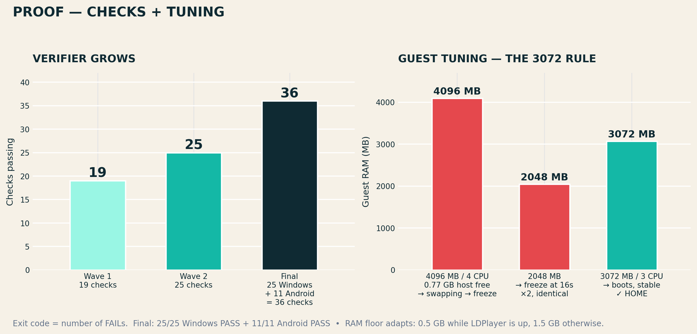
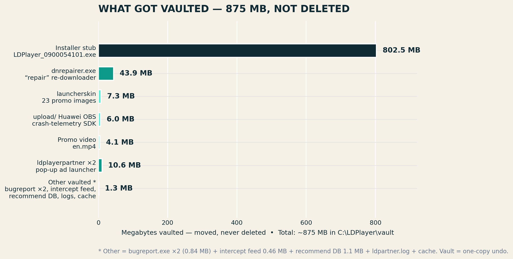
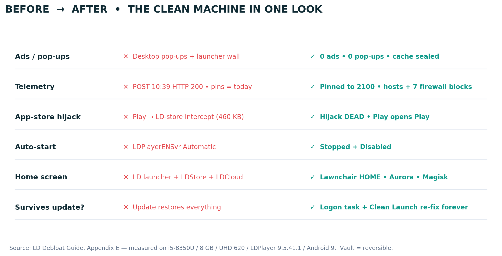

<p align="center">
  
</p>

<h1 align="center">LD Debloat Guide</h1>
<p align="center"><strong>Strip LDPlayer 9 down to a clean, silent, self-healing Android emulator &mdash; the complete, no-nonsense playbook.</strong></p>

<p align="center">
  
  
  
  
  
</p>

---

## Read the guide

### [**`LD-Debloat-Guide.pdf` — the field manual (1.7 MB)**](LD-Debloat-Guide.pdf)

Step-by-step from a stock bloated LDPlayer 9 to a lean, telemetry-free, self-healing instance. Written for complete beginners, tested on a real machine twice (including surviving a full LDPlayer update that wiped everything and re-armed the bloat).

---

## The proof

**RAM — before → after** (animated; measured on the reference rig — LD itself idles at ~150–600 MB, the win is the headroom around it):



**The fixes that froze the machine — and how the fix stands:**



**What got vaulted — 875 MB, not deleted** (everything reversible):



**Before → after, one look:**



---

## What changed on this machine (same numbers as the benchmarks)

| | Before | After |
|---|---|---|
| Host free RAM (Brave open, same box) | **0.77 GB** → swap, "Not Responding" | **3.35 GB** → healthy |
| Guest CPU / RAM | 4 CPU / 4096 MB → freezes, 16-s boot wedge | **3 CPU / 3072 MB cap** → stable |
| Telemetry | POST HTTP 200 at 10:39 (today) | Zero reachable endpoints, pins to 2100 |
| App-store hijack | Google Play installs → LD-store twins | Dead (`ldmarket://` → No activity found) |
| Packages in-guest | 81 with LD bloat enabled | 84: LD bloat disabled; Lawnchair · Aurora · Magisk installed |
| Survives updates | Restored twice (proven) | Logon task + Clean Launch re-fix forever |
| Verifiers | none — you found problems by opening it | **25/25 Windows · 11/11 Android PASS** |

---

## What the toolkit is

- `reapply-debloat.ps1` — the master fixer. Idempotent, self-elevating, re-vaults every update-restored file.
- `clean-launch.ps1` (+ Desktop shortcut) — debloat sweep, launch LDPlayer, watcher re-sweep ~75 s later (catches the launch-time re-download).
- `android-refresh.ps1` — ADB-side re-fix: LD packages disabled, Private DNS, Lawnchair HOME.
- `verify-debloat.ps1` / `verify-android.ps1` — 25 + 11 read-only checks; exit code = number of FAILs.
- `LDPlayerDebloatEnforce` — logon scheduled task. Updates can win once. Never twice.

Full scripts print verbatim inside the PDF (Appendix G) — nothing in this repo depends on any one machine existing.

---

## Verify it yourself

```powershell
# after any update:
powershell -File C:\LDPlayer\verify-debloat.ps1      # want: ALL CHECKS PASSED
powershell -File C:\LDPlayer\verify-android.ps1      # want: ALL ANDROID CHECKS PASSED (emulator up, adb on)
```

---

## Honest notes (read these)

- **LD itself idles at a few hundred MB.** 3 GB is the guest's *cap*, not its appetite; the freeze came from Brave (~2 GB) + Windows (~3 GB) eating the headroom. Numbers are from the reference rig, not a lab.
- **Every launch re-fetches LD's intercept feed** (~2 min in) and re-arms its pins. The feed is dead weight while the LD app-store/launcher packages stay disabled. The Clean Launch watcher re-vaults it automatically.
- **Windows 10 Lite was never modified** — only two marked, reversible additions (a fenced hosts block + 7 firewall rules for LD's ad executables). Nothing removed, nothing patched.
- **Magisk root is not automatic** — open Magisk → Install → Direct install → reboot (Step 12 of the guide).
- Nothing here is affiliated with LDPlayer / XuanZhi. Tools modify a user's own install; you do it at your own risk. It works because LD itself ships those switches.

## FAQ

**Do I need to be technical?** No. Steps 0–13 are written for total beginners; every command is copy-pasteable; every error has its fix listed.

**Will LDPlayer still update?** You can force/allow updates — the logon task re-runs the fix. You lose nothing; verify with one command.

**Where do I start?** [`LD-Debloat-Guide.pdf`](LD-Debloat-Guide.pdf) → Step 0. ~90 minutes once, then ~2 minutes per update forever.

## License & credits

[MIT](LICENSE) © DERYK-RYLOY and contributors. Built from a real, complete debloat of LDPlayer 9.5.41.1 on Windows 10 Lite — measured, not invented. Issues and PRs welcome; if your rig behaves differently, tell us — the numbers in this README are a baseline, not a gospel.
