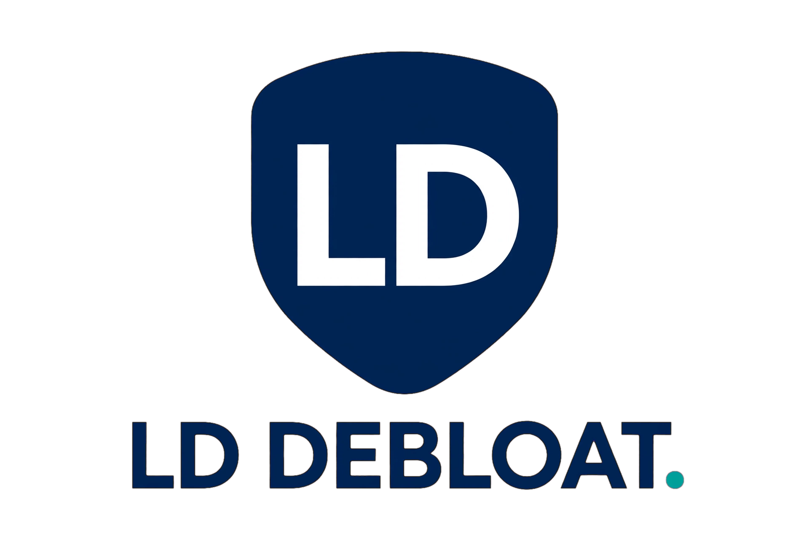

  

<h1 align="center">LD Debloat Guide</h1>

<strong>A clean, silent LDPlayer — the complete field manual.</strong>

  
  
  

---

### [**`LD-Debloat-Guide.pdf`**](LD-Debloat-Guide.pdf)

Step-by-step from a stock, ad-loaded LDPlayer to a lean, silent, self-healing instance — written for complete beginners and for any user of LDPlayer 9.x, out of the box.

`scripts/` holds the five files the guide uses as plain PowerShell (drop them in `C:\LDPlayer\` and go).

MIT License — © DERYK-RYLOY and contributors.
